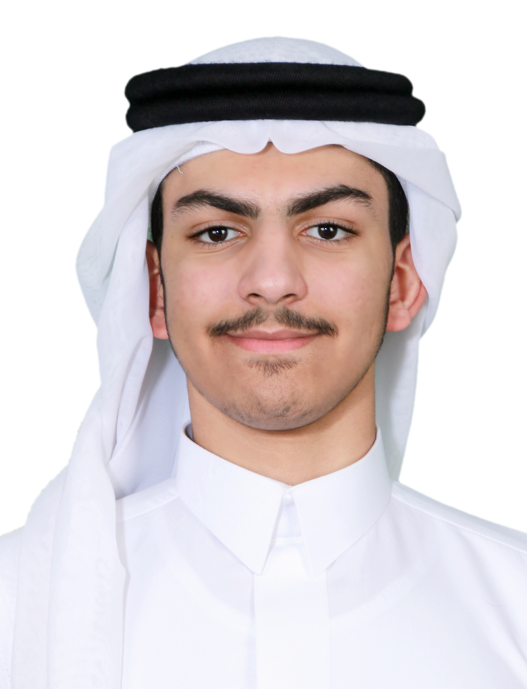
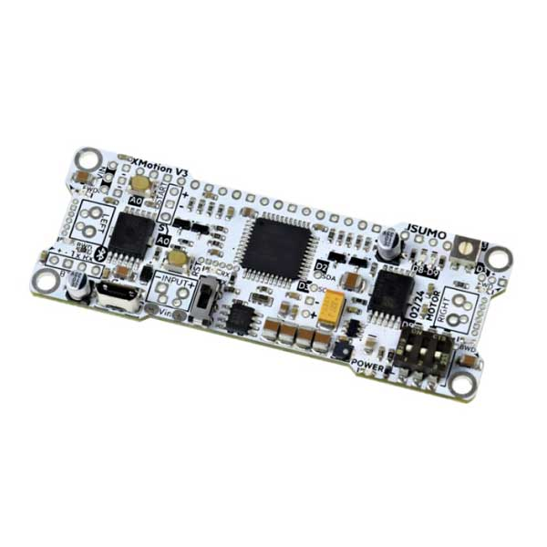
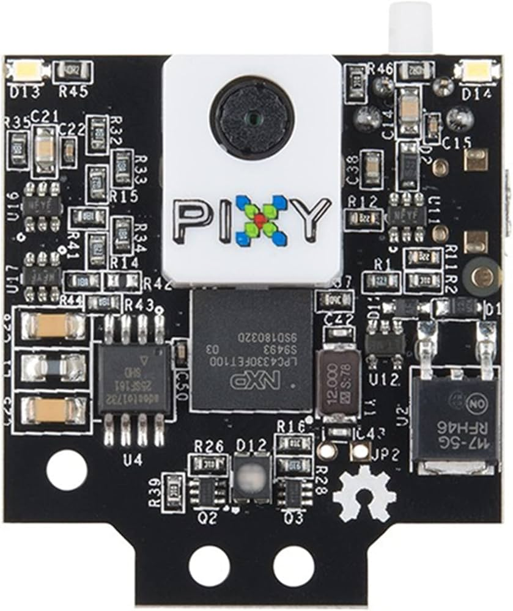
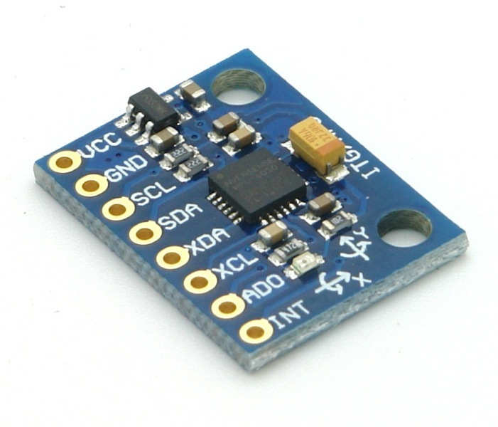

#  WRO 2026 Future Engineers – Jawatha Fighters

# Team 5565 – Al-Ahsa, Saudi Arabia

---

##  **SAUDI NATIONAL QUALIFIERS – JAWATHA FIGHTERS TEAM NO. 5565**

Welcome to the GitHub repository of **Team Jawatha Fighters**, competing in the **World Robot Olympiad™ (WRO®) Future Engineers 2026** category. We are a team of students from **Al-Ahsa, Saudi Arabia**, who designed **Sensoria** — a fully custom, autonomous self-driving vehicle built from the ground up for the WRO 2026 challenges. Named after the historic palm groves of our region, our robot combines custom 3D-printed mechanics, modular electronics, and robust control software into one integrated system.

**Team No.:** 5565  
**Region:** Al-Ahsa, Saudi Arabia  
**Achievement:** Saudi National Qualifiers

Performance demonstrations:
- **Open Challenge** – [Watch on YouTube](https://youtu.be/fPB93x9pTxI)
- **Obstacle Challenge** – [Watch on YouTube](https://youtu.be/hbKiM2jCgEo)

---

##  **Table of Contents**
- [ Repository Structure](#-repository-structure)
- [ The Team](#-the-team)
- [ Challenge Overview](#-challenge-overview)
- [ Our Robot](#-our-robot)
- [ Electronic Systems](#-electronic-systems)
- [ Mechanical Systems](#-mechanical-systems)
- [ Software Architecture](#-software-architecture)
- [ Performance Videos](#-performance-videos)
- [ License](#-license)

---

##  **Repository Structure** 

|  Folder | Contents |
|-----------|----------|
| **`src/`** | Main competition code (Open & Obstacle challenges), flowcharts, and sensor test sketches in `src/tests/` |
| **`schemes/`** | Full wiring diagram of all electrical connections ([wiring diagram.pdf](schemes/wiring%20diagram.pdf)) |
| **`datasheets/`** | Official datasheets for every major component (XMotion V3, Pixy2, MPU6050, HC-SR04, MG90s, FingerTech gearmotor, LiPo, PLA+) |
| **`part-photos/`** | Photos of the main electronic components |
| **`v-photos/`** | Multi-angle photos of the final robot (v3) and all earlier prototypes |
| **`t-photos/`** | Photos of team members and coach |
| **`videos/`** | Performance video files and [YouTube links](videos/Video%20Links) |
| **`docs/`** | Official WRO Future Engineers competition documentation |

---

##  **The Team** 

Team Jawatha Fighters is made up of two high-school students from Al-Ahsa, guided by a coach with a background in AI and robotics.

| Member | Role | Grade |
|--------|------|-------|
| **Mohammed Almossa** | Software development & deployment | 10th grade |
| **Mohammed Alsalman** | 3D design, hardware design & electronics | 10th grade |

**Coach:** **Hasan Abo Fares** – Team coach, with a background in AI and robotics.

<em>Left to right: Mohammed Almossa (Software), Mohammed Alsalman (Mechanical & Electronics), Coach Hasan Abo Fares</em>

---

##  **Challenge Overview** 

##  **WRO 2026 Future Engineers – Two Autonomous Challenges**

### ** Open Challenge**
Complete **three autonomous laps** on a walled track whose internal walls are re-arranged between rounds.

| Aspect | Challenge | Our Solution |
|--------|-----------|--------------|
| **Track layout** | Random internal wall placement each round | Direction-agnostic wall-following algorithm |
| **Navigation** | Unknown number/position of corners | Front ultrasonic corner detection + timed turns |
| **Precision** | Consistent distance from walls | P-controlled wall following (target 25 cm) |

### ** Obstacle Challenge**
Complete **three laps** while reacting to red and green traffic pillars, choosing the correct passing side:
- **Red pillar** → robot must pass on its **right**
- **Green pillar** → robot must pass on its **left**

**Our implementation:** a Pixy2 camera trained on two color signatures tracks the pillar in real time and biases the steering so the robot always passes on the correct side, while ultrasonic sensors keep handling walls and corners.

---

##  **Our Robot** 

**Sensoria** is built around a fully custom 3D-printed chassis — no off-the-shelf frame — designed in Fusion 360 and printed in PLA+.

**Core specifications:**
- **Dimensions:** 152.907mm (L) × 104 mm (W) × 133.1 mm (H)
- **Weight:** ~415 g
- **Drive:** Rear-wheel drive (RWD), high-traction rubber tires
- **Steering:** Servo-actuated Ackermann-style steering linkage

<em>Sensoria v3 – final competition configuration</em>

### Processing & Perception
- **Main controller:** XMotion V3 all-in-one robot controller (Arduino Leonardo compatible, ATmega32U4) — runs all logic and has built-in motor drivers
- **Vision:** Pixy2 CMUcam5 smart camera (onboard color-signature detection, 60 FPS)
- **Distance sensing:** 3× HC-SR04 ultrasonic sensors (left, center, right)
- **Motion sensing:** MPU6050 6-axis IMU (gyro + accelerometer)
- **Actuation:** FingerTech Silver Spark 16mm gearmotor (drive) + TowerPro MG90s servo (steering)
- **Power:** Galaxy 3S 11.1 V LiPo battery pack

---

##  **Electronic Systems** 

Our electronics are built around the **XMotion V3** controller, which integrates the Arduino Leonardo-compatible microcontroller and dual motor drivers on a single board — no separate motor driver module is needed.

### **Component Overview**

| Component | Photo | Quantity | Function |
|-----------|-------|----------|----------|
| **XMotion V3** |  | 1 | Main controller, logic & motor driving |
| **Pixy2 CMUcam5** |  | 1 | Vision – red/green pillar detection |
| **MPU6050 IMU** |  | 1 | Rotation & motion sensing |
| **HC-SR04 Ultrasonic** | — | 3 | Wall & corner distance (L/C/R) |
| **FingerTech Silver Spark 16mm Gearmotor** | — | 1 | Rear-wheel propulsion |
| **TowerPro MG90s Servo** | — | 1 | Steering actuation |
| **Galaxy 3S 11.1V LiPo** | — | 1 | Main power source |

>  **Every component datasheet is available in the [`datasheets/`](datasheets) folder.**

### **Wiring**
The complete electrical layout — every connection between the controller, sensors, camera, servo, motor, and battery — is documented in the [full wiring diagram](schemes/wiring%20diagram.pdf).

### **Design Notes**
- The **side ultrasonic sensors are angled outward by 15°** to eliminate blind spots when approaching wall corners at steep angles.
- A **recessed battery tray** lowers the center of gravity, preventing roll in high-speed turns.
- **Isolated wire-routing channels** in the chassis floor separate high-current motor wires from sensor signal lines, preventing electrical noise.

---

##  **Mechanical Systems** 

Sensoria evolved through **three prototype generations**, each fixing a measured problem:

| Iteration | Problem Found | Fix Applied |
|-----------|---------------|-------------|
| **v1.0** | Frame flex near the front steering hub during tight cornering | Added vertical support ribs and gussets |
| **v2.0** | Side ultrasonic sensors had blind spots at wall corners | Angled the outer sensor mounts outward by 15° |
| **v3.0** | Camera tower vibration during acceleration broke Pixy2 tracking | Dual-braced elevated camera mount integrated into the floor pan |

<table>
<tr>
<td align="center" width="33%">

<strong>Design v1 – First Prototype</strong> 
<em>The original proof-of-concept chassis. Testing exposed frame flex near the front steering hub, which led to the reinforced v2.</em>
</td>
<td align="center" width="33%">

<strong>Design v2 – Reinforced Frame</strong> 
<em>Added support ribs and gussets, and angled the side ultrasonic sensors 15° outward to eliminate corner blind spots.</em>
</td>
<td align="center" width="33%">

<strong>Design v3 – Final Competition Robot</strong> 
<em>Dual-braced camera mount fixed vision vibration; final competition configuration of Sensoria.</em>
</td>
</tr>
</table>

<em>Design evolution: first concept → reinforced v2 → final v3</em>

<em>Ackermann-style steering system in motion</em>

### **Print Settings**
- **Material:** eSUN PLA+
- **Infill:** 20% honeycomb with 4 perimeter walls (floor pan)
- **CAD:** Autodesk Fusion 360, printed on Bambu Lab

### **Future Mechanical Improvements**
- Ball bearings on steering pivots to reduce friction
- Camera mount with adjustable tilt angle
- Lighter wheel hubs to reduce rotating mass

---

##  **Software Architecture** 

All software is written in **Arduino C++** and runs on the XMotion V3's ATmega32U4. Upload is done over USB with the Arduino IDE (board: Arduino Leonardo).

### **Files**

| File | Purpose |
|------|---------|
| [`src/Open Challange Code`](src/Open%20Challange%20Code) | Open Challenge – autonomous wall following & cornering |
| [`src/Obstacle Challange Code`](src/Obstacle%20Challange%20Code) | Obstacle Challenge – adds Pixy2 red/green pillar avoidance |
| `src/tests/distance.ino` | Ultrasonic sensor test sketch |
| `src/tests/PixyNav.ino` | Pixy2 vision test sketch |
| `src/tests/imu.ino` | MPU6050 IMU test sketch |

### **How the Robot Thinks**

**Shared core (both challenges):**
1. Read left, center, and right ultrasonic distances.
2. **Direction decision:** at the first corner, whichever side has more free space becomes the "inside" — the robot then follows the wall on that side.
3. **Wall following:** a P-controller trims the steering to hold a fixed wall distance (25 cm in Open, 30 cm in Obstacle).
4. **Corner detection:** when the front sensor reads less than 45 cm, the robot locks full steering into the turn. The turn ends when the front clears 70 cm (minimum 0.5 s, timeout 2.5 s), then one corner is counted.
5. **Lap counting:** 12 corners = 3 laps × 4 corners. After the 12th corner the robot drives 1.5 more seconds, then stops.
6. **Safety stop:** if the front sensor loses its echo entirely, the motor cuts immediately.

**Obstacle Challenge addition (Pixy2):**
1. The Pixy2 is trained on two color signatures: **signature 1 = red, signature 2 = green**.
2. When a pillar block taller than 12 px is visible, the robot slows down and steers so the block sits at a target position in the image:
   - **Red → target x = 70** (left of frame) → robot passes on the **right** of the pillar ✔
   - **Green → target x = 246** (right of frame) → robot passes on the **left** of the pillar ✔
3. If no pillar is visible, it falls back to normal wall following at full speed.

### **Software Future Improvements**
- Fuse the MPU6050 gyro into turns for more consistent 90° cornering
- Add encoder-based odometry for lap-time measurement
- Adaptive speed that increases on straights and slows before detected corners

---

##  **License** 

This project is open for educational and competition use. Feel free to study, replicate, and build upon our work — just credit Team Jawatha Fighters.

##  **Team Jawatha Fighters – Team 5565 – Al-Ahsa, Saudi Arabia**

